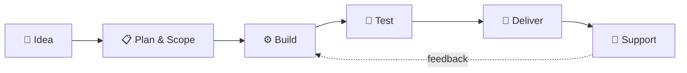

<div align="center">


<a href="https://github.com/Verslabs">
  
</a>

<br/>


</div>

---

## ⚡ About VersLabs

**VersLabs** is an independent software studio. We design, build, and ship clean, fast, and maintainable software — from **custom Minecraft server plugins** to **web apps, Discord bots, and backend services**.

```kotlin
object VersLabs {
    val focus     = listOf("Minecraft Plugins", "Software Development", "Web & APIs", "Automation")
    val platforms = listOf("Paper", "Spigot", "Purpur", "Velocity", "BungeeCord", "Fabric")
    val values    = listOf("Performance", "Clean Code", "Reliability", "Great Support")
    val status    = "Building something cool right now 🚀"
}
```

---

## 🧩 What We Do

<table>
<tr>
<td width="50%" valign="top">

### ⛏️ Minecraft Development
- Custom **Paper / Spigot / Purpur** plugins
- **Velocity & BungeeCord** proxy plugins
- **Fabric** mods & server-side tooling
- Minigames, economies, RPG systems & custom GUIs
- Database-backed data (MySQL, PostgreSQL, Redis, MongoDB)
- Performance profiling & optimization of existing plugins

</td>
<td width="50%" valign="top">

### 💻 Software Development
- Full-stack **web applications** & dashboards
- **REST & real-time APIs**
- **Discord bots** & community integrations
- Automation scripts & internal tools
- Cloud deployment, Docker & CI/CD pipelines
- Code reviews, refactors & maintenance

</td>
</tr>
</table>

---

## 🛠️ Tech Stack

<div align="center">

**Languages**


**Frameworks & Platforms**


**Data & Infrastructure**


**Tools**


</div>

---

## 🔄 How We Work



| Step | What happens |
| :--- | :--- |
| **💬 Idea** | You tell us what you need — a plugin, a bot, a full app. |
| **📋 Plan** | We scope features, timelines, and versions together. |
| **⚙️ Build** | Clean, documented code with regular progress updates. |
| **🧪 Test** | Tested on real environments before handoff. |
| **🚀 Deliver** | Source, builds, and setup docs delivered to you. |
| **🛟 Support** | Bug fixes and updates after release. |

---

## 📊 GitHub Stats

<div align="center">


</div>

---

## 📬 Work With Us

<div align="center">

Got a project in mind? A plugin idea? Need something fixed?
**We'd love to hear about it.**

<a href="https://github.com/Verslabs"></a>
<!-- Add your links below -->
<!-- <a href="https://discord.gg/YOUR_INVITE"></a> -->
<!-- <a href="https://your-website.com"></a> -->

</div>

---

<div align="center">

<sub>Crafted with 💜 by <b>VersLabs</b></sub>


</div>
